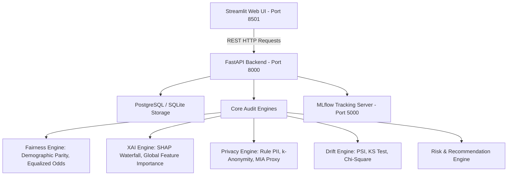

# FairGuard AI: Multi-Pillar Responsible AI Governance Platform

[](https://www.python.org/)
[](https://fastapi.tiangolo.com/)
[](https://streamlit.io/)
[](https://www.docker.com/)
[]()

FairGuard AI is a comprehensive, production-grade Responsible AI (RAI) auditing, explainability, and governance platform. It automates multi-pillar algorithmic risk assessments across **Fairness**, **Explainability**, **Privacy**, **Data Drift**, and **Unified Trust Scoring** with human-in-the-loop compliance reviews and persistent relational audit trails.

---

## 🏛️ Key System Architecture

FairGuard AI is designed as a decoupled, multi-tier enterprise platform:



- **Frontend**: Streamlit interactive dashboard with real-time backend health check, executive trustworthiness scorecard, interactive SHAP/fairness graphs, and human sign-off panel.
- **Backend**: High-performance FastAPI REST API exposing 14 endpoints conforming to the SRS specification.
- **Persistence**: Relational database (PostgreSQL for Docker production, automatic SQLite fallback at `artifacts/fairguard.db` for local zero-dependency testing) tracking datasets, models, assessments, module results, recommendations, human reviews, and monitoring runs.
- **Compliance & Governance**: Standardized risk scoring band (Low, Medium, High) with automated actionable recommendations and immutable audit trails.

---

## 📊 Datasets Supported

1. **UCI Adult Income Dataset (`adult`)**: 48,842 census records assessing gender and racial income equity.
2. **German Credit Benchmark Dataset (`german`)**: 1,000 credit applicant records auditing financial lending fairness across gender (`personal_status_sex`), age groups (`age_group`), and foreign worker status (`foreign_worker`).
3. **Synthetic Test Scenarios**:
   - `synthetic_biased.csv`: High disparate impact test suite for threshold calibration.
   - `synthetic_shifted.csv`: Population covariate and prediction drift validation data.
   - `synthetic_pii.csv`: Privacy leak stress-testing with synthetic SSNs, emails, phone numbers, and unique IDs.

---

## 🚀 Getting Started

### Option 1: Quickstart (Local Environment)

#### 1. Setup Virtual Environment
```bash
# Clone repository and navigate to root
cd FairGuard

# Create and activate virtual environment
python3 -m venv .venv
source .venv/bin/activate       # On Windows: .venv\Scripts\activate

# Install dependencies
pip install -r requirements.txt
```

#### 2. Start the FastAPI Backend
In your first terminal:
```bash
uvicorn api.main:app --host 127.0.0.1 --port 8000 --reload
```
API Documentation will be live at:
- **Interactive Swagger Docs**: `http://localhost:8000/docs`
- **ReDoc**: `http://localhost:8000/redoc`

#### 3. Start the Streamlit Frontend
In a second terminal:
```bash
streamlit run app.py
```
Open your browser at `http://localhost:8501`. The top status pill will display `🟢 FastAPI Backend Active`.

---

### Option 2: Production Containerization (Docker Compose)

FairGuard AI is fully containerized with automated health checks, network bridges, and PostgreSQL persistence:

```bash
# 1. Configure environment variables (optional)
cp .env.example .env

# 2. Build and launch all services
docker compose up --build
```

**Services Running:**
| Service | URL | Description |
| :--- | :--- | :--- |
| **Streamlit UI** | `http://localhost:8501` | Executive Governance & Audit Dashboard |
| **FastAPI REST API** | `http://localhost:8000` | Automated Auditing & Scorer API |
| **Swagger Documentation** | `http://localhost:8000/docs` | Interactive OpenAPI Specifications |
| **MLflow Server** | `http://localhost:5000` | Model Metric Tracking & Artifact Store |
| **PostgreSQL Database** | `localhost:5432` | 7-Table Relational Compliance Store |

To stop the containers:
```bash
docker compose down
```

---

## 🔌 FastAPI REST API Reference

All error responses strictly adhere to the standardized academic schema:
```json
{
  "error": "ErrorCategory",
  "detail": "Human-readable diagnostic description"
}
```

### Complete Endpoint Directory:

| Method | Endpoint | Description |
| :--- | :--- | :--- |
| `GET` | `/health` | Live service health check and database status |
| `GET` | `/datasets` | List available registered auditing datasets |
| `GET` | `/models` | List registered machine learning models (Model A, B, C) |
| `POST` | `/assessments` | Trigger a full 5-pillar assessment run and persist results |
| `GET` | `/assessments/{id}` | Retrieve comprehensive evaluation report and risk scores |
| `POST` | `/fairness` | On-demand group fairness evaluation (Demographic Parity, Equalized Odds) |
| `POST` | `/explanations` | Feature importance and SHAP summary generation |
| `POST` | `/privacy` | Privacy scan (PII detection, $k$-anonymity, MIA risk score) |
| `POST` | `/drift` | Covariate and prediction distribution drift (PSI, KS Test, Chi-Square) |
| `POST` | `/performance` | Standard classification metrics (Accuracy, ROC-AUC, F1, Log Loss) |
| `GET` | `/report` | Generate and download compliance audit report (PDF / HTML / Markdown) |
| `POST` | `/review` | Record human-in-the-loop review decision (`APPROVED`, `REJECTED`, `FLAGGED`) |
| `POST` | `/monitoring/evaluate`| Production drift and performance monitor with automated alert thresholds |
| `GET` | `/models/{id}/history` | Retrieve historical audit timeline and compliance drift for a model |

---

## 🧪 Verification & Testing

Run the automated test suites to verify system integrity:

```bash
# Test Phase 1 & Phase 2 (Pillars, Engines, Database CRUD, SQLite/PostgreSQL)
python3 tests/test_phase1_phase2.py

# Test Phase 3 & Phase 4 (FastAPI 14 Endpoints, Pydantic Schemas, Datasets)
python3 tests/test_api.py

# Quick Pipeline Smoke Test
python3 smoke_test.py

# Complete Integration Test (All models, XAI, Fairness, Governance)
python3 full_test.py
```

---

## 📂 Project Structure

```
FairGuard/
├── api/
│   ├── main.py              # FastAPI application (14 endpoints, CORS, exception handlers)
│   └── schemas.py           # Pydantic v2 validation models and error objects
├── app.py                   # Streamlit Frontend with dual-mode API/local fallback
├── docker/
│   ├── Dockerfile.backend   # Production container for FastAPI API
│   └── Dockerfile.frontend  # Production container for Streamlit UI
├── docker-compose.yml       # Production orchestration (backend, frontend, postgres, mlflow)
├── data/                    # Datasets (Adult Census, German Credit, synthetic suites)
├── input/                   # Pre-trained Model C files (.joblib) for multi-model comparison
├── src/
│   ├── database/
│   │   ├── models.py        # SQLAlchemy ORM definitions for 7 relational tables
│   │   ├── session.py       # Resilient SQLite/PostgreSQL connection manager
│   │   └── crud.py          # ACID database transactions and queries
│   ├── services/
│   │   ├── drift_service.py # Population Stability Index (PSI) and KS/Chi-Square tests
│   │   ├── privacy_service.py # PII scanner, k-anonymity, and MIA score proxy
│   │   └── risk_service.py  # Multi-pillar weighted risk scoring and recommendations
│   ├── fairness_engine.py   # Disparate impact and equality of opportunity
│   ├── xai_engine.py        # SHAP explainability and waterfall generation
│   ├── german_credit.py     # German Credit loader and benchmark generator
│   └── governance.py        # Dual persistence for human governance decisions
└── tests/                   # End-to-end unit and integration test suites
```

---

## 👥 Academic Credits & Acknowledgements

Developed under the Responsible AI Governance Framework, Project 23, Department of Artificial Intelligence & Data Science, Vishwakarma Institute of Technology (VIT Pune).
